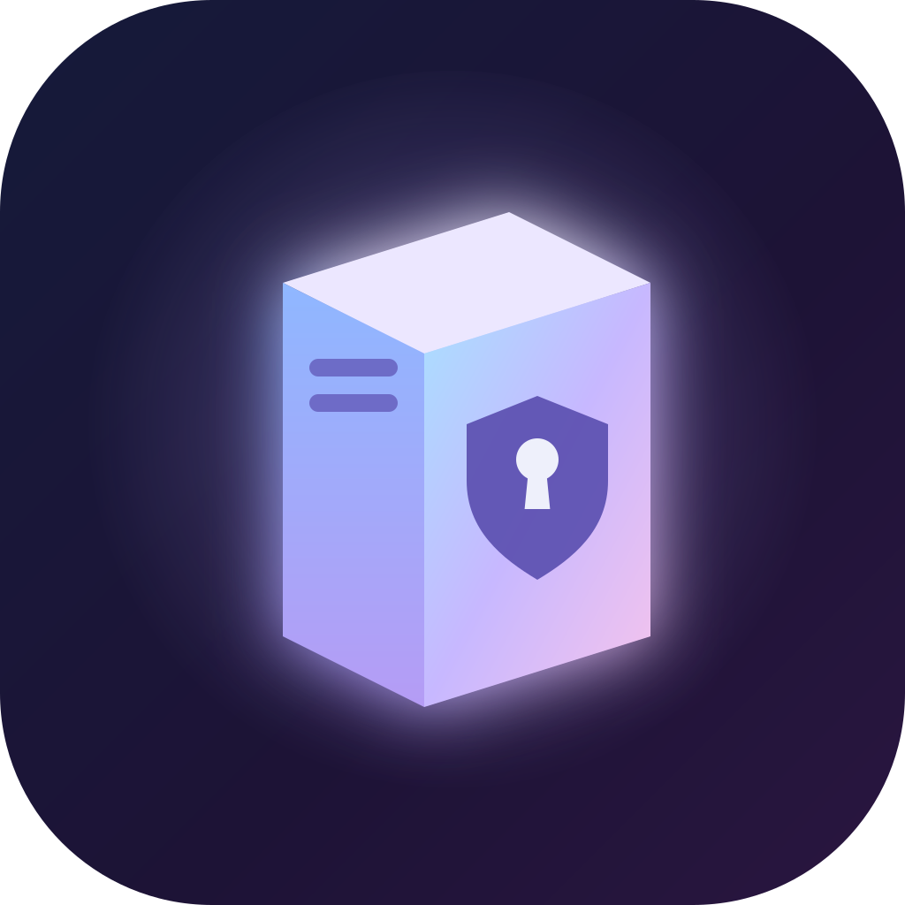
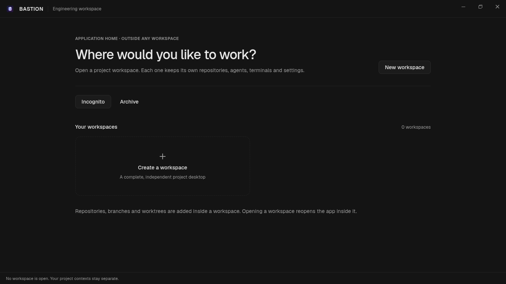

<h1 align="center">
   Bastion
</h1>

<p align="center">
  <strong>A DevOps workbench for real projects, with your own agents and tools.</strong><br/>
  Understand a repository, attach its cloud and cluster, change infrastructure through reviewed
  recipes, follow a revision to the running pods, and diagnose and recover when it breaks.
</p>

<p align="center">
  
  
  
</p>

<p align="center">
  
</p>

## What it does

- **Project workspaces.** Each workspace is an independent desktop with its own repositories,
  agents, terminals and settings. Leave one and resume it later exactly as it was; Incognito
  tasks leave nothing behind.
- **Discovery.** Reads the repository's real evidence (Kubernetes, containers, Terraform, CI)
  and lists what the code cannot tell you as open questions, instead of guessing.
- **Cloud targets.** Local Floci emulators for AWS, Azure, GCP and OCI, free and private; real
  AWS with your own profile, a verified identity and read-only checks. Cost Explorer reads are
  opt-in and confirmed one at a time.
- **Recipes.** Reviewed infrastructure (bucket, database, registry, secret, workload role)
  generated as ordinary Terraform you own. Validate with the project's pinned Terraform, apply to
  the emulator for free, or to real AWS after a plan preview and a one-use confirmation.
- **Delivery.** Follows one revision from commit through CI, the published image, the
  deployment config and Argo CD to the running pods, and marks each link verified, mismatched or
  unknown. A failed or missing check blocks promotion; promotion and rollback are reviewed
  one-line changes you commit.
- **Operations.** Diagnoses a failing workload (rollout, container state, events, previous
  logs, image → commit), runs journey checks with a kept history, and keeps runbooks as Markdown
  in your repository.

## Principles

- **Unknown is never healthy.** Anything Bastion cannot read is shown as unknown, with the
  reason.
- **Nothing behind your back.** Changes are files you review; real cloud changes show their plan
  and run once, after you confirm.
- **Your tools, your versions.** Tools come from the project's own `mise.toml`, never from
  the host.
- **Your credentials stay yours.** Bastion stores no cloud keys; real AWS uses your profile's
  own sign-in.

## Status

Release candidate for **Linux x64** and **macOS Apple Silicon** (unsigned). Windows and Intel
Macs are not built yet; remote (SSH) hosts are partly supported. See the [support matrix](docs/bastion/support-matrix.md) for exactly what
works where, and its known limits.

## Download

Get the latest installer from [Releases](https://github.com/nazmur96/bastion/releases/latest).

- **Linux x64:** `bastion-linux.AppImage` (make it executable, then run it), or the `.deb` /
  `.rpm` package for your distribution.
- **macOS Apple Silicon:** `bastion-macos-arm64.dmg`. Drag Bastion to Applications. The build
  is not signed or notarized yet, so macOS blocks the first launch: open **System Settings →
  Privacy & Security** and choose **Open Anyway**, or run
  `xattr -dr com.apple.quarantine /Applications/Bastion.app` once.

## Run it from source

Requires Node 24 and pnpm (see `packageManager` in `package.json`).

```sh
git clone https://github.com/nazmur96/bastion.git
cd bastion
pnpm install
pnpm dev
```

## Credits

Bastion is a fork of [Orca](https://github.com/stablyai/orca) by Lovecast Inc., used under the MIT license; Orca's
original README is kept at [docs/orca-README.md](docs/orca-README.md). The workbench, terminals, editor and agent
runtime are Orca's; project workspaces, discovery, cloud targets, recipes, delivery, operations and Bastion's look are this fork's.

## License

[MIT](LICENSE).
